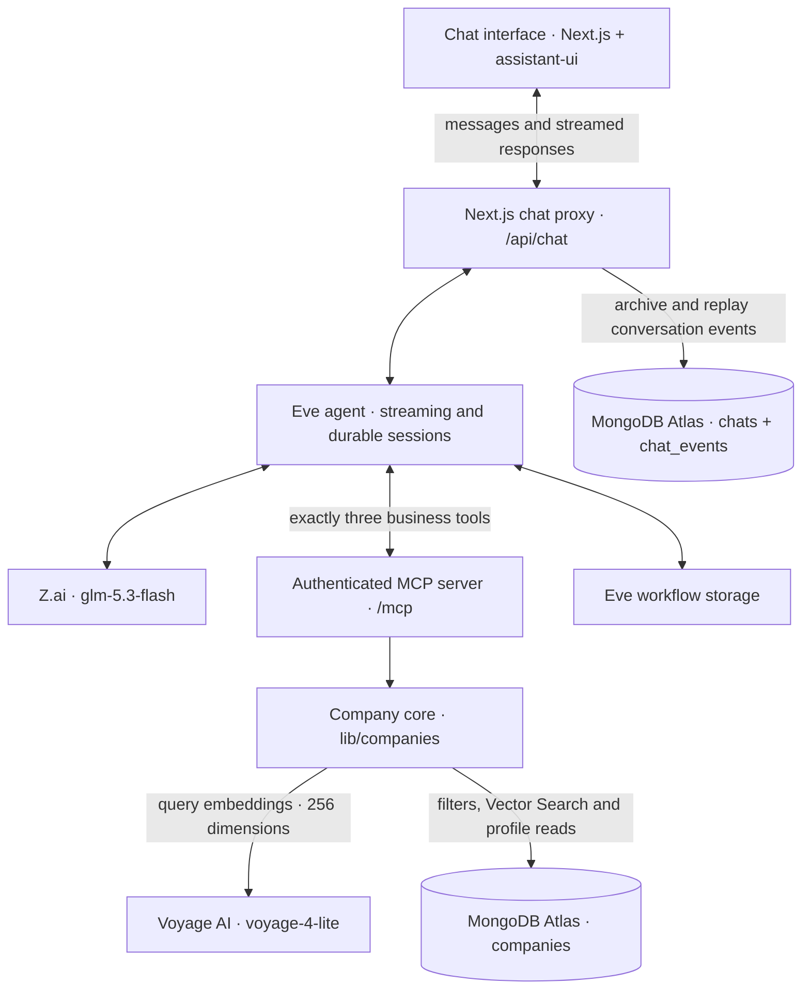

# Prospector AI

### Find your next great prospect.

Describe the companies you want to reach. Prospector AI turns that request into a ranked shortlist, explains each match, and lets you refine the search in the same conversation.

It searches a fixed dataset of **9,988 company records**, using semantic retrieval to find relevant candidates and deterministic scoring to rank them. The language model understands the request and coordinates the tools; the application calculates the scores.

[Try a search](#start-with-a-conversation) · [Architecture](#architecture) · [Run locally](#run-locally) · [Scoring](#how-scoring-works) · [Deploy](#first-vercel-deployment)

## Start with a conversation

Start with something like:

> Find software and IT services companies, preferably in Bangalore. Rank the top 10 and explain the matches.

Then narrow the shortlist:

> Only keep private companies with 51–200 employees.

Or explore a result:

> Show me the details of the first company.

You can also try pharmaceutical manufacturing, manufacturers near Mumbai, or a company-name lookup. A location preference keeps the search broad; an explicit requirement restricts the results.

The interface includes:

- **Ranked company tables** with scores, public attributes and match summaries.
- **Company profiles and CSV export** for taking results into your own workflow.
- **Follow-up searches** that retain your previous requirements while applying changes.
- **Saved conversations** with paginated history and chat deletion.
- **Dark and light themes**, responsive layouts, and a waiting message while the agent works.

The default recommendation is a **top 10**, or fewer when fewer eligible matches exist. Missing values stay visible as unknowns instead of being filled in by the model.

## Architecture

The application has three distinct responsibilities: conversation, company intelligence, and chat persistence.

Built with **Next.js 16**, **React 19**, **assistant-ui**, **Tailwind CSS 4** and **Eve**, backed by **MongoDB Atlas**, **Z.ai** and **Voyage AI**.



**Company tools are read-only.** They read company records and request query embeddings; they cannot insert, update or delete companies. The offline importer has its own write credential. Chat persistence uses a separate credential to save and delete conversations.

The business MCP server lives in [`app/mcp/route.ts`](app/mcp/route.ts) and exposes exactly three tools:

| Tool               | Responsibility                                                                       |
| ------------------ | ------------------------------------------------------------------------------------ |
| `search_companies` | Retrieve candidates using hard filters and an optional semantic query.               |
| `score_companies`  | Calculate requirement-match scores, rank candidates and return criterion breakdowns. |
| `get_company`      | Retrieve one complete normalized company profile.                                    |

Handlers validate inputs and outputs with strict Zod schemas, then delegate to the shared core. The agent connection has an explicit three-tool allowlist and uses a server-side bearer credential. Vocabulary and criteria guides help the agent build valid requests; they do not add business tools to the MCP server.

### From request to shortlist

1. **Understand the request.** The agent separates must-have requirements from preferences and maps categorical values to the observed dataset vocabulary.
2. **Find candidates.** Hard filters combine with semantic retrieval when the request describes a business activity. Voyage generates a 256-dimensional query embedding for MongoDB Vector Search.
3. **Score every retrieved candidate.** The agent passes the full candidate list to the scoring tool, which applies the requested criteria and selects the ranking.
4. **Explain the result.** The response uses the returned company names, scores and order. The frontend presents the ranked table and CSV export.
5. **Refine or inspect.** A refinement runs a fresh search and scoring pass. A details request resolves the company and retrieves its profile; duplicate names require clarification.

An unknown filter is reported with possible alternatives. A search with no matches asks before relaxing an explicit requirement.

## How scoring works

**Semantic similarity chooses candidates. Criteria determine their final scores.**

For each criterion, the core computes a match fraction and a weighted contribution:

```text
score = 100 × sum(weight × match fraction) / sum(all criterion weights)
```

- Categorical values, numeric comparisons and exact tags receive a full match or no match.
- Description and name criteria use the fraction of requested unique words present in the field. Partial word coverage produces a partial match.
- Missing values receive zero contribution and remain in the denominator.
- A required criterion must match fully; otherwise the company is excluded.
- Tied scores use a stable internal identifier as the tiebreaker.

By default, the agent gives the main business activity weight **3** and ordinary criteria such as location, company type, employee band and rating weight **1**, unless you specify numerical priorities.

The scoring function is pure and deterministic for the same records and criteria. Semantic candidates can change with query wording, embeddings or index updates. A score measures the supported requirements under these rules; it is not a probability of purchase or a measure of business quality.

## The dataset and its boundaries

The supplied Indian-company CSV contains **9,988 source records**. Some reported locations are outside India. Duplicate names and truncated source names are preserved, so the record count is not a count of unique companies.

Supported fields are name, description, recognized company type, reported location, employee band, source rating and tags. Industry and business activity are searched through descriptions and semantic retrieval rather than a verified industry classification.

The source includes missing and ambiguous values. Normalization retains the original values internally, records quality flags, and avoids treating malformed data as a reliable filter. Public profiles show unavailable values clearly.

The dataset does not provide verified revenue, incorporation dates, directors, CINs, current hiring signals or real-time enrichment. Employee counts are source bands such as `51-200`; undocumented numeric-only labels are not interpreted as ranges. Ratings are preserved without asserting an undocumented scale. Exact-word scoring does not perform synonym expansion, and simple criteria can produce many ties.

## Run locally

### 1. Prepare the environment

You need **Node.js 24+**, npm, an Atlas database, a Z.ai API key and a Voyage AI API key. The repository pins Node **24.21.0** in `.nvmrc`.

For a fresh checkout:

```bash
# If you use nvm
nvm use

npm ci
cp .env.example .env.local
```

If you already have `.env.local`, keep it and add any missing configuration. Environment files containing secrets and the raw dataset are ignored by Git.

### 2. Configure credentials

Fill in `.env.local` using this reference:

| Variable             | Purpose                                                                                                     |
| -------------------- | ----------------------------------------------------------------------------------------------------------- |
| `GLM_API_KEY`        | Standard Z.ai API key used by `glm-5.3-flash`.                                                              |
| `VOYAGE_API_KEY`     | Voyage key for document and query embeddings.                                                               |
| `MONGODB_URI`        | Read-only Atlas credential for the company tools.                                                           |
| `MONGODB_DB`         | Database containing the `companies` collection.                                                             |
| `MONGODB_CHAT_URI`   | Chat credential with read/write and index permissions on `chats` and `chat_events`. Required in production. |
| `MONGODB_CHAT_DB`    | Optional chat database; defaults to `MONGODB_DB`.                                                           |
| `MONGODB_IMPORT_URI` | Offline setup credential with company write and index-management permissions.                               |
| `MCP_API_KEY`        | Shared bearer secret used by the agent and the `/mcp` route.                                                |
| `MCP_SERVER_URL`     | `http://localhost:3000/mcp` locally; the public HTTPS `/mcp` endpoint when hosted.                          |

Company and chat collections can share the same Atlas cluster and database. Use separate MongoDB users for their permissions; a separate database is optional. Local development can fall back to `MONGODB_IMPORT_URI` for chat persistence if `MONGODB_CHAT_URI` is unset. Production disables that fallback.

All keys stay server-side. Do not give these variables a `NEXT_PUBLIC_` prefix.

### 3. Prepare the company database

If you are using an already populated database with a ready Vector Search index, skip to the next step.

For a new database, obtain the supplied CSV separately and place it at `data/indian_companies.csv`. The proprietary source file is not included in the repository.

```bash
npm run dataset:verify
npm run dataset:import -- --dry-run
npm run dataset:import
```

The dry run validates the source without API or database calls. The real import writes normalized records, generates Voyage embeddings, and creates and verifies the `company_embedding_v1` index. It uses `voyage-4-lite`, **256 dimensions** and cosine similarity.

Import is resumable: unchanged valid embeddings are reused and completed batches survive an interrupted run. New or changed text incurs embedding API usage. Use a dedicated company collection; the script refuses unrelated records or an incompatible existing vector index.

### 4. Start the application

```bash
npm run dev
```

Open **[localhost:3000](http://localhost:3000)** and try one of the starter suggestions. Atlas network access must permit the machine running the server.

Start the server from the checkout containing your changes. If another repo or worktree already owns port 3000, you may be looking at that copy of the application.

## Chat history and continuation

An HttpOnly browser cookie identifies the owner of a conversation. MongoDB stores chat summaries in `chats` and ordered Eve events in `chat_events`. History survives reloads, and deletion removes the owned chat and its archived events in a transaction.

Different browser profiles have separate histories. Clearing the identity cookie loses access to that browser's saved chats; cross-device history would require user accounts.

**Saved history and a resumable agent session are different things.** MongoDB can replay a transcript, while Eve's workflow storage owns the live agent state. Preserve that storage across restarts and deployments to continue sessions. If a session is no longer active, its saved history remains readable and the UI offers a new chat.

## Checks and evaluations

Run local checks from the repository root:

```bash
npm run test:core
npm run test:chats
npm run test:evals
npm run test:deployment
npm run lint
npx tsc --noEmit
```

The suites cover normalization, filter resolution, scoring, MCP validation and authentication, chat ownership and deletion, stream decoding, grounding assertions and production configuration.

With the dev server running and real credentials configured:

```bash
npm run mcp:try          # Exercise the three business tools
npm run agent:try        # Search, ranking, zero-result and details smoke checks
npm run agent:try-names  # Unique, duplicate and missing company-name lookups
npm run eval:companies  # 15 live evaluation conversations
```

Live checks use provider APIs and the configured database. Evaluation artifacts are written under `.eve/evals/`, which is ignored by Git. The agent's eight-business-call limit is an instruction policy; this Eve version does not enforce it as a runtime cap.

Build the frontend and agent runtime separately:

```bash
npm run build
npm run build:eve
```

The frontend build uses webpack. A successful frontend build alone does not verify the Eve runtime, provider calls, database connectivity or session continuation.

## First Vercel deployment

Local deployment preparation is implemented. A hosted end-to-end smoke test is still required before treating the demo as verified.

1. Import the repository as a Next.js project and select **Node.js 24.x**.
2. Add the required server-side environment variables from the table above. Production requires a dedicated `MONGODB_CHAT_URI`. Do not upload `.env.local` or the offline import credential.
3. Set `MCP_SERVER_URL` to `https://<your-public-host>/mcp`. The deployment check rejects localhost, non-HTTPS URLs, credentials in the URL, and paths other than `/mcp`.
4. Permit Atlas connectivity from the hosted runtime. The chat user needs `find`, `insert`, `update`, `remove` and `createIndex` on `chats` and `chat_events`; provision those collections first if the user cannot create them.
5. Deploy. [`vercel.json`](vercel.json) runs `npm run deploy:build`, which checks configuration before the frontend build. The `withEve` integration generates the additional Eve service and its checked build command. Verify that the account supports the required service and Workflow runtime.
6. Configure deployment protection so reviewers and the agent can reach the public demo. The prototype's Eve channel permits anonymous access; the business MCP route separately requires its bearer credential.

Configure the same required variables for Preview deployments, including the correct preview MCP endpoint and matching secret.

To validate a prospective hosted environment, supply the values in your shell and run:

```bash
npm run deploy:check
```

To inspect your local environment file:

```bash
node --env-file=.env.local scripts/check-deployment.ts
```

A localhost MCP URL intentionally fails this production check. Diagnostics report missing variable names and configuration problems without printing secret values. They do not validate credential permissions, provider balance or service availability.

### Verify before sharing

Open the deployed URL in a fresh browser without a Vercel login and check:

- The page and `GET /eve/v1/health` load, with health reporting `status: "ready"`.
- A company search returns scored results and a ranked top 10 when enough matches exist.
- A follow-up applies the new criteria while preserving the existing requirements.
- Company profiles load and CSV export matches the displayed data.
- Reload preserves history and a saved live conversation accepts a new message.
- A fresh browser profile has its own chat history.
- An unauthenticated request to `/mcp` returns `401`.

## Finding your way around the code

| Path                                                             | What lives there                                                                |
| ---------------------------------------------------------------- | ------------------------------------------------------------------------------- |
| [`app/`](app/)                                                   | Next.js pages, layout, styles, chat API routes and the MCP endpoint.            |
| [`components/chat-workspace.tsx`](components/chat-workspace.tsx) | Sidebar, saved-chat lifecycle and starter suggestions.                          |
| [`components/assistant-ui/`](components/assistant-ui/)           | Thread, composer, response tables, export and working states.                   |
| [`agent/`](agent/)                                               | GLM configuration, instructions, Eve channel, MCP connection and agent guides.  |
| [`lib/companies/`](lib/companies/)                               | Schemas, normalization, embeddings, retrieval, pure scoring, details and tests. |
| [`lib/chats/`](lib/chats/)                                       | Browser identity, transcript storage, stream decoding and ownership checks.     |
| [`lib/deployment/`](lib/deployment/)                             | Production environment validation and tests.                                    |
| [`scripts/`](scripts/)                                           | Dataset preparation, import, live smoke checks and deployment diagnostics.      |
| [`evals/companies/`](evals/companies/)                           | Live agent scenarios and deterministic grounding checks.                        |

## When something looks wrong

| Symptom                                          | First thing to check                                                                      |
| ------------------------------------------------ | ----------------------------------------------------------------------------------------- |
| The old interface appears on localhost           | Confirm which checkout's dev server owns port 3000.                                       |
| Eve fails to start                               | Check `node --version`; Node 24+ is required.                                             |
| Search or history is unavailable                 | Check Atlas network access, the appropriate credential, and the configured database.      |
| Filters match but semantic results do not appear | Confirm `company_embedding_v1` is ready and uses the expected 256-dimensional vectors.    |
| A valid search returns no companies              | Check exact source vocabulary and try a broader preference instead of a hard requirement. |
| Old chats cannot continue after a restart        | Check Eve workflow persistence; create a fresh chat if the live session has expired.      |
| Production configuration fails locally           | A localhost MCP endpoint is valid for development but fails the hosted-environment check. |
